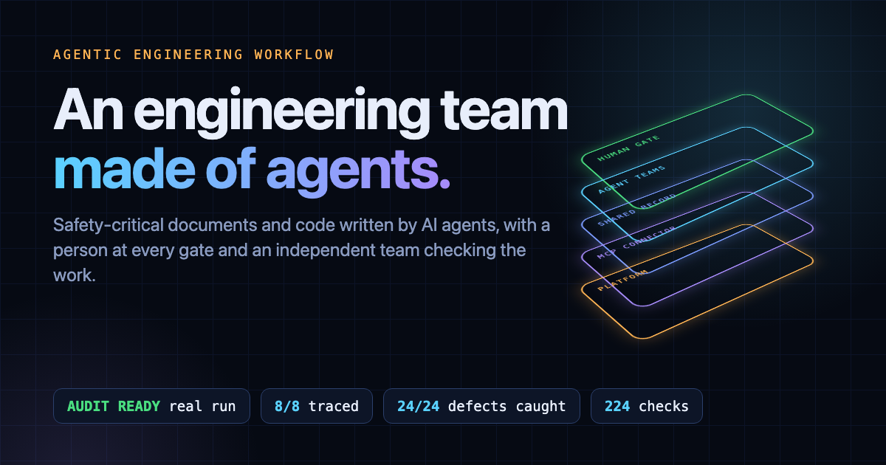

# Agentic Engineering Workflow

An interactive walkthrough of an engineering team made of AI agents. Seven development agents write requirements, design, code and tests. A separate compliance team audits the result without ever talking to them, and a person approves every step.

**Live page:** https://yashrao10.github.io/agentic-engineering-workflow/

## Real results

From one end to end run on a sample brief (Windows, through WSL):

| Result | Value |
|---|---|
| Verdict | AUDIT READY, publish gate held for a person |
| Requirements traced to code and tests | 8 of 8 |
| Planted defects caught by the generated tests | 24 of 24 |
| Agent time, brief to audit-ready package | 9m 47s |
| Automated checks (none call a model) | 224 |

## What the page shows

1. **Real run.** The results card from that run.
2. **The idea.** A human engineering team, mapped onto agents.
3. **Watch it run.** One run three ways: an animated step by step diagram, 3D agents you can spin, and the five layers of the stack.
4. **Inside one agent.** The loop every agent runs, where the model is allowed to run, and what happens when the audit fails.
5. **The firewall.** Why the team that builds it cannot talk to the team that checks it.
6. **Traceability.** Break the audit yourself, then follow one real requirement from the customer request down to the generated code and its passing test.
7. **Do the tests work.** Mutation checks: break a copy of the code and see whether a test notices.
8. **Publishing.** The five guards in front of a one-way write, and the package that comes out.
9. **My part and lessons.**
10. **Where it stands.** What is done, what is proven, what is next, plus a plain-English glossary.

## About this repo

A single self-contained HTML page: no build step and no dependencies beyond Google Fonts. The examples use invented sample briefs. This is a learning and explanation project, not a product.
